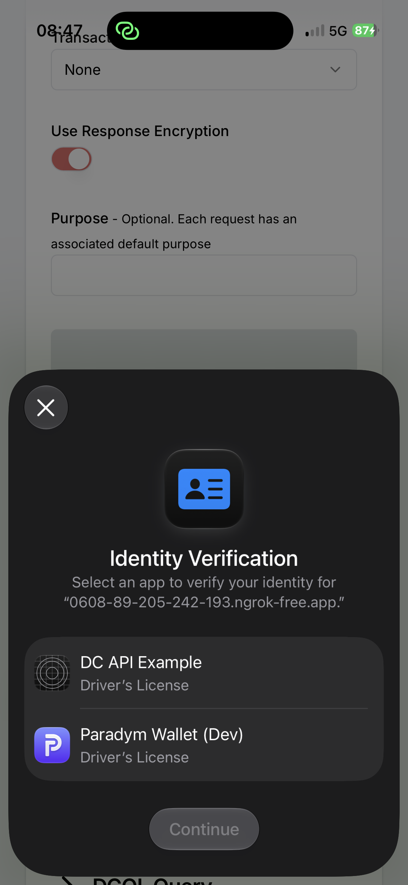
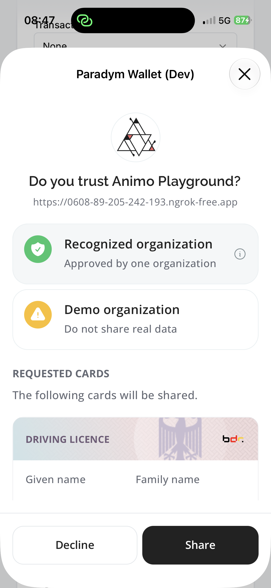
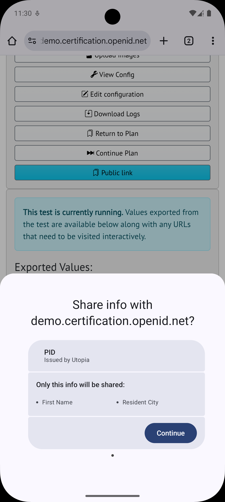
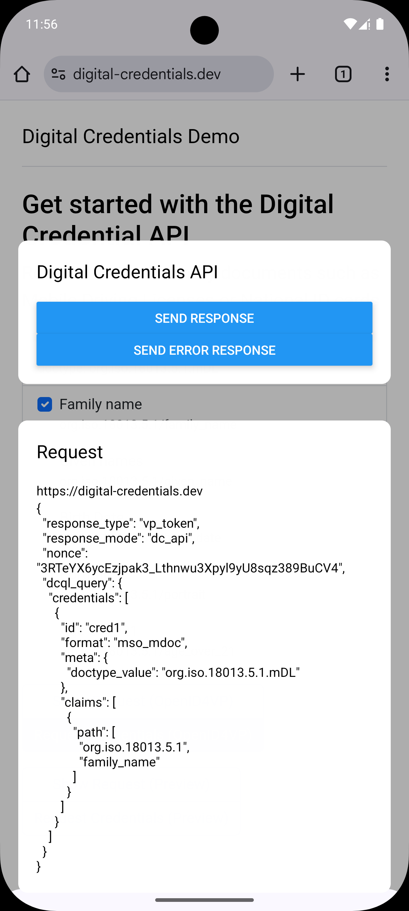

<p align="center">
  <picture>
   <source media="(prefers-color-scheme: light)" srcset="https://res.cloudinary.com/animo-solutions/image/upload/v1656578320/animo-logo-light-no-text_ok9auy.svg">
   <source media="(prefers-color-scheme: dark)" srcset="https://res.cloudinary.com/animo-solutions/image/upload/v1656578320/animo-logo-dark-no-text_fqqdq9.svg">
   
  </picture>
</p>

<h1 align="center" ><b>Expo - Digital Credentials API</b></h1>

<h4 align="center">Powered by &nbsp; 
  <picture>
    <source media="(prefers-color-scheme: light)" srcset="https://res.cloudinary.com/animo-solutions/image/upload/v1656579715/animo-logo-light-text_cma2yo.svg">
    <source media="(prefers-color-scheme: dark)" srcset="https://res.cloudinary.com/animo-solutions/image/upload/v1656579715/animo-logo-dark-text_uccvqa.svg">
    
  </picture>
</h4><br>

<p align="center">
  <a href="https://typescriptlang.org">
    
  </a>
  <a href="https://www.npmjs.com/package/@animo-id/expo-digital-credentials-api">
    
  </a>
  <a
    href="https://raw.githubusercontent.com/animo/expo-digital-credentials-api/main/LICENSE"
    ></a>
</p>

<p align="center">
  <a href="#getting-started">Getting Started</a> 
  &nbsp;|&nbsp;
  <a href="#usage">Usage</a> 
  &nbsp;|&nbsp;
  <a href="#contributing">Contributing</a> 
  &nbsp;|&nbsp;
  <a href="#contributing">License</a> 
</p>

---

An [Expo Module](https://docs.expo.dev/modules/overview/) to automatically set up and configure the [Digital Credentials API](https://digitalcredentials.dev) for Android and iOS in Expo apps.

This library is tested with **Expo 58** and **React Native 0.88**.

| | Android | iOS |
|---|---|---|
| Protocol `openid4vp` | ✅ | ❌ (not supported by the platform) |
| Protocol `org-iso-mdoc` (ISO/IEC TS 18013-7:2025 Annex C) | ✅ | ✅ |
| Protocol `openid4vp-v1-{unsigned,signed,multisigned}` | ✅  | ✅ from iOS 27.3, built with the iOS 27.3 SDK |
| Minimum OS version | Credential Manager with registry support | iOS 26 |
| Credential matching | wasm matcher bundled with this library | performed by the OS |

Three wasm matchers are bundled for Android. Only Multipaz, the default, supports `org-iso-mdoc`.

<div align="center">
  <table>
    <tr>
      <th align="center" colspan="2">iOS</th>
      <th align="center" colspan="2">Android</th>
    </tr>
    <tr>
      <td></td>
      <td></td>
      <td></td>
      <td></td>
    </tr>
    <tr>
      <td align="center"><sub>Credential picker</sub></td>
      <td align="center"><sub>Request UI</sub></td>
      <td align="center"><sub>Credential picker</sub></td>
      <td align="center"><sub>Request UI</sub></td>
    </tr>
  </table>
</div>

## Getting started

```sh
npm install @animo-id/expo-digital-credentials-api   # or yarn add / pnpm add
```

Configure the plugin ([below](#configuration)), then `npx expo prebuild` so the native dependency is added.

### Configuration

Both platforms render the same React component from its own bundle, configured with a single config plugin. Add it to your app config:

```json
[
  "@animo-id/expo-digital-credentials-api",
  {
    "ios": {
      "documentTypes": ["org.iso.18013.5.1.mDL", "eu.europa.ec.eudi.pid.1"],
      "excludedPackages": ["react-native-maps"]
    }
  }
]
```

| Option | Default | Description |
|---|---|---|
| `entry` | `dc-api/index` | Bundle root of the request UI, relative to the project root and without extension. Metro resolves platform variants, so `dc-api/index.ios.tsx` works. |
| `ios.documentTypes` | — | Document types for the `…identity-document-services.document-provider.mobile-document-types` entitlement, from Apple's [allowed set](#supported-document-types). **The iOS extension is only generated when this is set.** |
| `ios.verifiableCredentialTypes` | none | SD-JWT VC types (`vct` values) for the `…identity-document-services.document-provider.verifiable-credential-types` entitlement, e.g. `urn:eudi:pid:1`. On iOS 27.3 and later the `dc+sd-jwt` credentials of these types are registered, and the wallet answers OpenID4VP requests for them. Left out of the entitlements when empty. See [Verifiable credential types](#verifiable-credential-types). |
| `ios.excludedPackages` | see below | React Native or Expo packages with native code to leave out of the extension's autolinking, by npm package name.|
| `ios.includedPackages` | — | The inverse: link only these React Native or Expo packages, leave out everything else. Setting both throws. |
| `ios.appGroup` | `group.<bundleId>` | App group shared by the app and the extension. This package stores nothing in it by default, but it provides a storage directory accessible by both the main application and the DC API app extension. See [Sharing storage with the request UI](#sharing-storage-with-the-request-ui). |
| `ios.keychainAccessGroup` | `<bundleId>` | Keychain access group shared by the app and the extension. The default is where keys are created by default if you haven't configured an access group, meaning no migration is needed. Using a custom value might require a migration/rotation of keys, if the keys are not already available in this access group.  |
| `ios.bundleIdSuffix` | `DocumentProvider` | Suffix appended to the app's bundle identifier for the extension. |
| `ios.deploymentTarget` | `26.0` | Deployment target of the extension. Must be at least iOS 26 (first iOS version DC API was added). The app's own is untouched, so it stays installable on older iOS. |
| `ios.fonts` | none | Fonts the request UI renders with, by file name as the app bundles them. See [Appearance](#appearance). |
| `ios.userInterfaceStyle` | the app's | Appearance the request UI renders in: `light`, `dark` or `automatic`. See [Appearance](#appearance) before pinning it, as there's some caveats. |
| `ios.backgroundColor` | system background | Background behind the request UI, `#RRGGBB` or `#RRGGBBAA`. Visible behind the sheet's title bar, before the JS renders, and wherever your screen is transparent, including insets you pad rather than paint. See [Appearance](#appearance). |

Every option except `entry` is iOS-only. Android needs no configuration, and applying the plugin with no options at all is valid.

#### Keeping it small

The request UI is bundled separately from the app. On iOS it runs in an app extension under a much
tighter memory budget, and everything the app links is linked into it by default. Trim it with
`ios.excludedPackages` (npm package names, applied to Expo modules and React Native autolinking
alike), or with `ios.includedPackages` once the list to leave out is longer than the list to keep:

```json
["@animo-id/expo-digital-credentials-api", {
  "ios": {
    "documentTypes": ["org.iso.18013.5.1.mDL"],
    "includedPackages": ["react-native-keychain", "react-native-safe-area-context"]
  }
}]
```

They fail in opposite directions, which is the thing to weigh: a package missing from
`excludedPackages` only makes the extension heavier, while one missing from `includedPackages` makes
it fail to link. Setting both throws.

`@animo-id/expo-digital-credentials-api`, `react-native`, `expo`, `expo-modules-core` and
`expo-asset` are always linked, the extension cannot start without them, and excluding one is
ignored with a warning. `expo-dev-client`, `expo-dev-launcher`, `expo-dev-menu`, `expo-router`,
`expo-splash-screen` and `expo-updates` are always excluded, since they drive the app's lifecycle or
use APIs extensions do not have.

Keep the imports under your entrypoint minimal. JS-only libraries count too, which often means
importing single components instead of whole barrels. **Never import an excluded package under your
entrypoint, it will fail at runtime.**

#### Appearance

iOS draws a sheet around the request UI, titled with the app's display name (`expo.name`). Android
hosts it in a transparent, untitled activity. Either way your screen paints what the user sees, so
give it a background. `ios.backgroundColor` pins the colour *behind* it, visible before the JS
renders, wherever your screen is transparent, and behind the sheet's title bar.

> **The sheet's title colour is the OS's, and follows the device.** iOS draws it in the device's
> appearance over a background you paint, and there are unfortunately no APIs to style it. So 
> `ios.userInterfaceStyle` only reaches this extension's own views. A light request UI on a dark
> device puts a white title on a light sheet, invisible. Either pick a `ios.backgroundColor` that
> both black and white text read against, or set `ios.userInterfaceStyle: 'automatic'`, leave
> `ios.backgroundColor` unset and theme your screen for both appearances.

`ios.userInterfaceStyle` defaults to your app's, so an app pinned to light gets a light request UI.

The room your screen gets differs per platform:

- **iOS** hands you the system sheet: already full height, already titled. Fill it (`flex: 1`).
  Rounding the top or capping the height puts a sheet inside a sheet. The top inset below the title
  bar is applied natively (`react-native-safe-area-context` cannot see OS chrome above the React
  Native view). The bottom edge is yours, so pad for the home indicator.
- **Android** gives you a transparent activity over the verifier's app, so your screen *is* the
  sheet: bottom aligned, rounding its own top, keeping its own height.

The app's fonts do not exist in the extension: `UIAppFonts` installs fonts for the bundle that
declares them, and the extension is a separate bundle. Name the ones the request UI draws with, by
file name as the app bundles them, and they are registered at launch from the app's bundle. They are
read in place, never copied, so nothing ships twice:

```json
["@animo-id/expo-digital-credentials-api", {
  "ios": { "documentTypes": ["org.iso.18013.5.1.mDL"], "fonts": ["OpenSans_400Regular.ttf"] }
}]
```

A font name the app does not bundle fails the prebuild. In your screen a `fontFamily` still names the
font's PostScript name (`OpenSans-Regular`), not the file.

#### Supported document types

iOS can only register the following document types:

- `org.iso.18013.5.1.mDL`
- `org.iso.23220.photoid.1`
- `org.iso.23220.1.jp.mnc`
- `eu.europa.ec.eudi.pid.1`
- `eu.europa.ec.av.1`

Your app is entitled to the ones you list in `ios.documentTypes`, and that list — not the full set
above — is what registration filters on: a credential whose document type the app is not entitled to
is rejected by the OS, so it is skipped before it gets there. Everything else is filtered out too, so
the same registration flow works on both platforms. See [Apple Documentation](https://developer.apple.com/documentation/bundleresources/entitlements/com.apple.developer.identity-document-services.document-provider.mobile-document-types) for more information.

#### Verifiable credential types

From iOS 27.3 the OS also matches SD-JWT VCs, for OpenID4VP requests. Your app is entitled to the
`vct` values you list in `ios.verifiableCredentialTypes`. Apple publishes no allowed set, and its
documentation names `urn:eudi:pid:1`, for an EU PID. A credential is registered by its `vct` and its
`extendedVcts`, keeping the ones the app is entitled to, and skipped when none are. See
[Apple Documentation](https://developer.apple.com/documentation/bundleresources/entitlements/com.apple.developer.identity-document-services.document-provider.verifiable-credential-types)
for more information.

The OpenID4VP support is compiled in when the app is built with Xcode 27.3 or later. Older Xcode
versions build the extension without it.

> [!WARNING]
> Provisioning profiles can't carry the `…verifiable-credential-types` entitlement yet, so a signed
> build that sets `ios.verifiableCredentialTypes` fails to sign. Simulator builds are not checked
> against a profile.

## Usage

### Registering credentials

Registration is what makes your wallet show up in the system credential picker. On Android, every call replaces
the whole set, so pass all credentials each time they change. On iOS you can also add and remove individual credential registrations.

Check `isSupported()` first, it is the only call that is always safe. Everything else throws
`DcApiUnsupportedError` on iOS below 26 and on Android without Credential Manager's registry API.

```ts
import {
  type DcApiCredential,
  getRegistrationStatus,
  isSupported,
  registerCredentials,
} from "@animo-id/expo-digital-credentials-api";

const credentials: DcApiCredential[] = [
  {
    id: "mdl",
    display: {
      title: "Drivers License",
      subtitle: "Issued by Utopia",
      // displayValue overrides how the picker renders the value; see below.
      claims: [{ path: ["org.iso.18013.5.1", "family_name"], displayName: "Family Name" }],
      // Optional, and shown in the picker: iconDataUrl: "data:image/png;base64,…"
    },
    credential: {
      format: "mso_mdoc",
      doctype: "org.iso.18013.5.1.mDL",
      namespaces: { "org.iso.18013.5.1": { family_name: "Glastra", age_over_18: true } },
    },
  },
  {
    id: "pid",
    display: {
      title: "PID",
      claims: [{ path: ["address", "city"], displayName: "Resident City" }],
    },
    credential: {
      format: "dc+sd-jwt",
      vct: "eu.europa.ec.eudi.pid.1",
      claims: { first_name: "Timo", address: { city: "Somewhere" } },
    },
  },
];

async function syncRegisteredCredentials() {
  if (!isSupported()) {
    console.log('DC API not supported');
    return
  }

  // iOS prompts on the first registerCredentials call; this reads where that stands without
  // prompting.
  const status = await getRegistrationStatus();
  if (status === "notAuthorized") return;

  const registered = await registerCredentials({
    credentials,
    android: { matcher: "multipaz" },
  });

  // ['mdl', 'pid'] on Android and iOS 27.3, ['mdl'] on earlier iOS: the SD-JWT cannot be
  // presented there.
  console.log(registered);
}
```

Credentials the platform cannot present are skipped rather than rejected, so you can pass the whole set
on both platforms. On iOS only `mso_mdoc` credentials with a document type the app is entitled to —
the plugin's [`ios.documentTypes`](#supported-document-types) — register, and from iOS 27.3
`dc+sd-jwt` credentials with a type in [`ios.verifiableCredentialTypes`](#verifiable-credential-types).
The returned ids say which did.

**On iOS the credentials never leave your app.** Only the identifier, document type and the `ios`
gates are handed over, and nothing is kept. The registered ids are how you find your own credentials
again when a request comes in. Android needs a good deal more, because its matcher runs in a sandbox
with no access to your app. See [What each platform registers](#what-each-platform-registers).

iOS keeps the registered set itself, so a document can be added or dropped on its own:

```ts
// iOS only — on Android, call registerCredentials again with the new set.
await registerCredential({ credential: newlyIssuedMdl });
await removeCredential("mdl");
```

| Function | Platform | Description |
|---|---|---|
| `isSupported()` | both | Whether the API exists at all. Synchronous, and never throws. |
| `getRegistrationStatus()` | both | `'authorized' \| 'notAuthorized' \| 'notDetermined' \| 'notSupported'`. Reads the iOS permission without prompting. Always `'authorized'` on Android, which needs no permission. |
| `registerCredentials(options)` | both | Replaces the registered set. Returns the ids that registered. |
| `registerCredential(options)` | iOS | Adds one credential, leaving the rest of the registered set alone. Throws on Android, where the registry is replaced as a whole. |
| `removeCredential(id)` | iOS | Drops one credential. Throws on Android, so call `registerCredentials` with the remaining credentials instead. |
| `removeAllCredentials()` | both | Drops everything this package registered. |
| `getSharedContainerPath()` | iOS | Path of the app group container the app and the request UI share. Synchronous. See [Sharing storage with the request UI](#sharing-storage-with-the-request-ui). |

On Android you choose the matcher: the wasm module Credential Manager runs to match your credentials
against the request.

| Matcher | Protocols | Icons | Claim values | Several credentials per request | Reports the matched request |
|---|---|---|---|---|---|
| `multipaz` (default) | `openid4vp`, `openid4vp-v1-*`, `org-iso-mdoc` | ✅ | ✅ | ✅ | Protocol only, see [what was picked](#what-was-picked) |
| `ubique` | `openid4vp` | ✅ | ✅ | ❌ | ✅ |
| `cmwallet` | `openid4vp` | ❌ | ❌ | ❌ | ✅ |

All three support SD-JWT VC and mdoc, signed and unsigned. Sources:
[multipaz](matcher/README.md) (Apache-2.0, our copy with payment support),
[oid4vp-wasm-matcher](https://github.com/UbiqueInnovation/oid4vp-wasm-matcher/releases/tag/v0.1.0),
[CMWallet](https://github.com/digitalcredentialsdev/CMWallet/blob/f4aa9ebbeaf55fa3973b467701887464be3d4b51/app/src/main/assets/openid4vp.wasm).

`android.protocols` defaults to everything the chosen matcher supports. Registering a protocol it
cannot answer throws. Each call clears the previous registry, so switching matcher or protocol never
leaves credentials showing twice.

#### What each platform registers

The two platforms match in different places, so they need different things from you.

On iOS the OS does the matching, and Apple's registration record has five fields: the document
identifier, the document type (the credential types for an SD-JWT VC), the issuer and reader
[authority key identifiers](#trusting-issuers-and-readers) and the `ios.invalidationDate`. That is all the OS gets. No
display metadata, no namespaces, no element identifiers and no claim values. The credentials stay in
your own storage, and this package keeps no copy of them.

Since the record holds no elements, iOS matches on the document type alone, after the reader trust
gate. A verifier asking for `family_name` on an mDL surfaces every registered mDL, including one that
does not carry that element. Working out what you can satisfy is the request UI's job. The
requested namespaces and elements arrive with the request, and you look up the credential behind the
identifier yourself. See [Handling the request](#handling-the-request).

On Android the matching runs in a wasm sandbox with no access to your app, so everything it needs has
to be handed over up front. `registerCredentials` encodes the display metadata (title, subtitle,
icon) and the claim values into the database Credential Manager stores and runs the matcher against.
The matcher can filter on individual claims, so a credential that is missing a requested claim never
reaches the picker.

|  | iOS | Android |
|---|---|---|
| Where matching happens | in the OS | in the wasm matcher, in a sandbox |
| What leaves the app | identifier, document type, issuer and reader identifiers, expiry | display metadata, claim values, issuer and reader identifiers |
| Matched on | document type | individual claims |
| Formats | `mso_mdoc` with an [allowed document type](#supported-document-types), and from iOS 27.3 `dc+sd-jwt` with an [entitled type](#verifiable-credential-types) | anything the matcher supports |
| Registered set | added to and removed from per credential | replaced on every call |

So on iOS a request the user picked your wallet for can still be one you cannot answer. Handle that
in the request UI instead of assuming the OS filtered it out.

#### Trusting issuers and readers

Two options on the credential gate matching on both platforms. Both take base64 X.509 authority key
identifiers, and values that are not valid base64 throw.

| Option | What it does |
|---|---|
| `issuerAuthorityKeyIdentifiers` | The authority key identifier of every certificate in the credential's issuer chain: the MSO's `x5chain` for an mdoc, the `x5c` header for an SD-JWT VC. A verifier can name the issuers it accepts, as `trusted_authorities` of type `aki` in DCQL or as `issuerIdentifiers` in an Annex C `deviceRequest`. A credential registered with issuer identifiers only matches if it carries one of them. Registered without, it still matches on iOS, but never on Android. |
| `supportedAuthorityKeyIdentifiers` | Reader gating. Empty (the default) matches every request, signed or not, and trust decisions are yours to make in the request UI. When set, the credential only matches requests whose reader certificate chain carries one of these: a signed OpenID4VP request, or a `deviceRequest` with `readerAuth`. Unsigned requests never match, and the user sees no entry for your wallet. |

```ts
await registerCredentials({
  credentials: [
    // Any reader may ask for this one.
    mdl,
    {
      ...pid,
      // Matches verifiers that only accept PIDs from this issuer.
      issuerAuthorityKeyIdentifiers: ["N1OrmtAijM/4g9xcF7evzmkzXVs="],
      // Only offered to readers the government signed for.
      supportedAuthorityKeyIdentifiers: ["Ej4mAJk…"],
    },
  ],
});
```

The platforms differ in who applies them:

- **iOS.** The OS stores both with each document and applies them while matching. Issuer identifiers
  are registered from iOS 27 and ignored before.
- **Android.** Only the `multipaz` matcher reads them, and it only compares identifiers. It verifies
  no signature and no chain, so check what reaches the request UI there too. The other matchers ignore
  `trusted_authorities`, so they have no use for issuer identifiers. They cannot gate on the reader
  either, and registering `supportedAuthorityKeyIdentifiers` with them throws.

#### Payments on Android

Set `android.transactionDataTypes` on a credential to the OpenID4VP `transaction_data` types it can
authorize. Only the `multipaz` matcher supports this, and registering it with the others throws.

- A credential query that `transaction_data` entries name in their `credential_ids` only matches
  credentials that list the type of every one of them, as OpenID4VP requires the wallet to authorize
  all of it. Credentials without `transactionDataTypes` only match the other queries.
- Set `android.transactionDataOnly` too and the credential only matches such queries. A payment card
  with it is not offered for a request that only asks for its claims.
- For `urn:paso:sca:global:payment:1` and `urn:eudi:sca:eu.europa.ec:payment:single:1`, the picker shows a
  payment: `payload.payee.name` as the merchant, `payload.amount` as the amount (with `EUR` shown as `€`), and the credential as
  the payment method. Two payments for one credential get the regular entry instead.
- A request with `transaction_data` that cannot be read, or that names no credential query, matches nothing.

```ts
await registerCredentials({
  credentials: [
    {
      ...card,
      android: { transactionDataTypes: ["urn:paso:sca:global:payment:1"], transactionDataOnly: true },
    },
  ],
});
```

The matcher only reads the request. Validate the transaction and show it in the request UI, and add
the `transaction_data_hashes` to the response.

#### Expiring a registration on iOS

`ios.invalidationDate` is when the OS should stop matching a document. After that date the credential
is not matched against, without having to run to unregister anything.

```ts
await registerCredentials({
  credentials: [{ ...mdl, ios: { invalidationDate: new Date("2027-01-01T00:00:00Z") } }],
});
```

Leave it out for no expiry. A date in the past throws. Once it passes the OS stops matching silently,
so drop the credential from your own storage too. Android has no equivalent.

#### Sharing storage with the request UI

On iOS the request UI runs inside the provider extension, a separate process that cannot see the
app's container. Since iOS has no system picker, every wallet has to look credentials up while
answering a request, so the database belongs in the shared app group container.

The config plugin sets the app group up in both targets, and `getSharedContainerPath()` resolves it
in whichever process asks:

```ts
import { Platform } from "react-native";
import { getSharedContainerPath } from "@animo-id/expo-digital-credentials-api";

// The same path in the app and in the request UI, so both open the same file. Android's default
// location already works.
const directory = Platform.OS === "ios" ? getSharedContainerPath() : undefined;

// expo-sqlite takes it third, op-sqlite as `location` — check yours.
const db = await SQLite.openDatabaseAsync("wallet.db", {}, directory);
```

Moving an existing database there needs care:

- Treat it as a migration. A database in the app's documents directory is invisible to the
  extension, so copy the file plus its `-wal` and `-shm` siblings once.
- Two processes now share one file. Use WAL mode, keep the extension's writes short, and never hold
  a transaction open across the user's decision.
- The path changes across reinstalls, so store the file name rather than the absolute path.

On Android the request UI also runs in its own process, `<your package>:dcapi`. That process lives in
the app's sandbox, so the default locations work and `getSharedContainerPath()` throws there. The app
and the request UI still open the same files from two processes, so the rules above apply on Android
too. Key-value stores need their multi-process mode, such as MMKV's `mode: 'multi-process'`.

### Handling a credential request

Once the user picks a credential from your wallet, your own component is rendered as an overlay to
approve the request.



#### Registering the component

The request UI has one entry file for both platforms, `dc-api/index.tsx` by default. It is bundled on
its own, so it registers the component itself:

```tsx
// dc-api/index.tsx
import { registerDcApiScreen } from "@animo-id/expo-digital-credentials-api/request-handler";
import { MyCustomComponent } from "./MyCustomComponent";

export default registerDcApiScreen(MyCustomComponent);
```

Platform variants resolve as usual. Add `dc-api/index.ios.tsx` or `dc-api/index.android.tsx` for a
different component per platform, or point the plugin's `entry` option elsewhere.

Keep the app's own entry (`index.ts`, or the Expo Router root) out of this file. The request UI runs
in a process of its own on both platforms (the provider extension on iOS, the picker's activity on
Android), and neither loads the app bundle.

`expo-updates` is not available under this entry on either platform, whether or not the app uses it.
The request UI always runs the bundle it was built with, so it has nothing to update.

#### Handling the request

The registered component gets `request: DcApiRequest`, a union on `kind`, since requests carry
different things at this point:

- **`kind: "raw"`** carries the protocol requests themselves. Nothing is parsed for you: read the
  OpenID4VP request or Annex C `deviceRequest`, reader authentication included, with whatever stack
  you already use. The same code handles both platforms.
  - On **Android** they come with the picker result, along with the credentials the user chose.
  - On **iOS 27.3** and later there is one request, the one the user picked your wallet for, and no
    picker: you select the credentials yourself.
- **`kind: "parsed"`** is an Annex C request before iOS 27.3. The OS holds the raw request back until
  you commit. Up front you get the request *as the OS parsed it* (which documents, which elements),
  and render consent and credential selection from that. `approve()` then releases the real thing.

`platform` tells the platforms apart for what only one of them has, such as Android's `selection`.

```ts
type DcApiRequest =
  | {
      platform: "android";
      kind: "raw";
      origin: string | undefined;
      callingPackage: string;
      requests: DcApiProtocolRequest[];
      selection?: {
        credentialIds: string[];
        requestIndex: number | undefined;
        candidateRequestIndexes: number[];
      };
      respond(options: DcApiResponseOptions): Promise<void>;
      decline(reason?: string): void;
    }
  | {
      platform: "ios";
      kind: "raw";
      origin: string;
      requests: DcApiProtocolRequest[];
      respond(options: DcApiResponseOptions): Promise<void>;
      decline(reason?: string): void;
    }
  | {
      platform: "ios";
      kind: "parsed";
      origin: string;
      presentmentRequests: IosPresentmentRequest[];
      readerAuthentications: { certificateChain: string[] }[];
      approve(): Promise<IsoMdocProtocolRequest[]>;
      respond(options: IsoMdocResponseOptions): Promise<void>;
      decline(reason?: string): void;
    };
```

`DcApiRawRequest` is the union of the two raw variants.

| Prop | Request | Description |
|---|---|---|
| `origin` | all | WHATWG ASCII serialization of the requesting website origin, always from the OS. On Android it is `undefined` when a native app asked for itself. See [below](#when-there-is-no-origin). |
| `requests` | raw | The [protocol requests](#protocol-requests) the verifier sent, in its order. Protocols this package does not know are left out, so this can be empty. On iOS it holds at most one. |
| `callingPackage` | raw, Android | The package that made the request, e.g. `com.android.chrome`. |
| `selection` | raw, Android | What the user picked in the system picker: the credentials, and the request they were matched against. `undefined` when the request did not come through the picker. See [what was picked](#what-was-picked). |
| `presentmentRequests` | parsed | [What the OS parsed](#the-parsed-request-ios) out of the request: documents, elements, and their `intentToRetain`. |
| `readerAuthentications` | parsed | The reader authentications the request carried, each with its certificate chain as base64 DER. Empty when the request was not signed. |

| Method | Platform | Behaviour |
|---|---|---|
| `approve()` | parsed | Commits to answering, and resolves with the protocol request the OS then releases. Always exactly one `org-iso-mdoc` request, in the same shape Android's `requests` has. Call it after the user approved. |
| `respond({ protocol, data })` | all | Completes the request. See [responding](#responding). Rejects once the request was answered or declined. A response that failed can be retried, or declined. |
| `decline(reason?)` | all | Declines. The reason is for logs, and the OS decides what the verifier sees. Does nothing once the request was answered or declined. |

##### Protocol requests

Every request describes its protocol requests the same way. A raw request's `requests` and what a
parsed request's `approve()` resolves with are the same `DcApiProtocolRequest[]`.

```ts
type DcApiProtocolRequest =
  // openid4vp | openid4vp-v1-unsigned | openid4vp-v1-signed | openid4vp-v1-multisigned
  | { protocol: Openid4vpProtocol; data: Record<string, unknown> }
  | { protocol: "org-iso-mdoc"; data: { deviceRequest: string; encryptionInfo: string } };
```

| Protocol | `data` | Platform |
|---|---|---|
| `openid4vp` | The draft protocol identifier, with the unsigned or signed shape below. | Android |
| `openid4vp-v1-unsigned` | The request parameters themselves, e.g. `{ response_type, nonce, dcql_query, … }`. | Android, iOS 27.3 |
| `openid4vp-v1-signed` | `{ request }`, a compact JWS. Verify the signature before trusting anything in it. | Android, iOS 27.3 |
| `openid4vp-v1-multisigned` | `{ payload, signatures }`, a JWS JSON serialization with one signature per client identifier. | Android, iOS 27.3 |
| `org-iso-mdoc` | ISO/IEC TS 18013-7:2025 C.2: `deviceRequest` and `encryptionInfo`, both base64url-no-pad encoded CBOR. | both |

Chrome sometimes sends `data` JSON encoded. Android parses it before it reaches JS, and drops an entry
whose `data` is no JSON object. iOS hands over the same shapes.

##### What was picked

`selection` is what the wasm matcher wrote into the picker entries the user chose. Its indexes are
mapped back onto `requests` after unknown protocols are dropped.

```ts
type AndroidDcApiSelection = {
  credentialIds: string[];
  requestIndex: number | undefined;
  candidateRequestIndexes: number[];
};
```

**Several credentials.** A request can ask for more than one credential at once: a DCQL query with
several `credentials`, `credential_sets` whose options combine credentials, or an Annex C
`deviceRequest` with several `docRequests`, optionally grouped by `deviceRequestInfo.useCases`. The
`multipaz` matcher turns each way of answering into a set of credentials, with one slot per
credential the request needs and a choice of credentials in each slot. An optional credential set
shows up as separate options, with and without it. The user confirms one set, and `credentialIds`
holds one credential per slot. This works the same for OpenID4VP, with SD-JWT VC or mdoc, and for
`org-iso-mdoc`. Answer with all of them in one response: a `vp_token` entry per DCQL credential query,
or a document per credential in the Annex C `DeviceResponse`.

`credentialIds` is in the order the picker returns them, which is not necessarily the order of the
query, and the matcher does not say which DCQL credential query each one answers. Match them against
the request to find out. `ubique` and `cmwallet` only register single credentials, so with those
`credentialIds` always has one entry.

**The matched request.** `requestIndex` is the request the credentials were matched against, when
the matcher's answer identifies one. `ubique` and `cmwallet` report the request itself. `multipaz`
only reports the protocol: its entry ids are `<combination> <protocol> <credentialId>` and carry no
request index. So when the verifier sent several requests with the same protocol, `requestIndex` is
`undefined` and `candidateRequestIndexes` lists all of them. The matcher answers the first request
the registered credentials can satisfy, so the one it matched is the first candidate the picked
credentials satisfy:

```ts
function matchedRequestIndex({ requests, selection }: AndroidDcApiRequest) {
  if (!selection) return undefined;

  return (
    selection.requestIndex ??
    // `isSatisfiedBy` is your own DCQL or deviceRequest evaluation.
    selection.candidateRequestIndexes.find((index) => isSatisfiedBy(requests[index], selection.credentialIds))
  );
}
```

`candidateRequestIndexes` is empty when the matched request uses a protocol this package does not
know, since that request is not in `requests`.

##### The parsed request (iOS)

`presentmentRequests` mirrors `ISO18013MobileDocumentRequest.presentmentRequests` one to one:

```ts
type IosPresentmentRequest = {
  // PresentmentRequest.isMandatory
  isMandatory: boolean;
  documentRequestSets: {
    // DocumentRequestSet.requests
    documentRequests: {
      // DocumentRequest.documentType
      doctype: string;
      // DocumentRequest.namespaces, with ElementInfo.isRetaining as intentToRetain
      namespaces: Record<string, Record<string, { intentToRetain: boolean }>>;
    }[];
  }[];
};
```

```ts
// A request for the family name and portrait from an mDL:
[
  {
    isMandatory: true,
    documentRequestSets: [
      {
        documentRequests: [
          {
            doctype: "org.iso.18013.5.1.mDL",
            namespaces: {
              "org.iso.18013.5.1": {
                family_name: { intentToRetain: false },
                portrait: { intentToRetain: true },
              },
            },
          },
        ],
      },
    ],
  },
];
```

`intentToRetain` is the verifier's claim about whether it will store an element rather than only check
it. Show it in your consent screen, but nothing enforces it.

The nesting carries the verifier's logic, and the wallet has to honour it:

- **`presentmentRequests`**: every request marked `isMandatory` must be answered, the others may be
  left out.
- **`documentRequestSets`**: *exactly one* set answers a presentment request. The sets are
  alternatives, and choosing between them is the only structural choice you have.
- **`documentRequests`**: *every* document in the chosen set must be answered, so one response can
  carry several.

Match this against your own credential storage to find which credentials can answer. The library
keeps no copy, see [Sharing storage with the request UI](#sharing-storage-with-the-request-ui).
[`example/dc-api/DcApiScreen.tsx`](example/dc-api/DcApiScreen.tsx) walks the whole structure.

Android has no equivalent and needs none: `request.requests` is the real request from the start.

##### Responding

`respond()` takes the protocol you answered and that protocol's data object.

It uses the shape the Digital Credentials API itself uses: a `protocol` and its `data`.

```ts
type DcApiResponseOptions =
  | { protocol: Openid4vpProtocol; data: Record<string, unknown> }
  | { protocol: "org-iso-mdoc"; data: { response: string } };
```

| Protocol | `data` |
|---|---|
| `openid4vp*` | The OpenID4VP authorization response. What goes in it is OpenID4VP's business: `{ vp_token: … }`, or `{ response: "<JWE>" }` when the request asked for encryption. |
| `org-iso-mdoc` | The ISO/IEC TS 18013-7:2025 C.3 response: `{ response: "<base64url-no-pad EncryptedResponse>" }`. |

The types enforce which protocols you can answer: a parsed request takes only `org-iso-mdoc`, so an
un-narrowed `DcApiRequest` does too. Narrow on `kind` before answering OpenID4VP. On iOS a raw
request has to be answered over the protocol it came in over, or `respond` rejects.

Answering or declining closes the request UI. On Android its process ends with it, which cuts off
anything still running. Write what you need to keep, such as an activity log entry, before you call
`respond()` or `decline()`.

##### Putting it together

Answering both protocols, on both platforms.

```tsx
import type { DcApiProtocolRequest, DcApiRequest } from "@animo-id/expo-digital-credentials-api/request-handler";
import { Button, View } from "react-native";

export function MyCustomComponent({ request }: { request: DcApiRequest }) {
  const onShare = async () => {
    if (request.kind === "parsed") {
      // iOS before 27.3 releases an Annex C request only once the wallet commits to answering it,
      // so this belongs behind the user's approval.
      const [isoMdoc] = await request.approve();
      if (!isoMdoc) return request.decline("no protocol this wallet can answer");

      // There is no picker on iOS: the credentials are the ones your own screen matched against
      // `presentmentRequests`.
      return request.respond({
        protocol: "org-iso-mdoc",
        data: { response: await buildAnnexCResponse(isoMdoc.data, request.origin, chosenCredentialIds) },
      });
    }

    // A raw request, the same on both platforms apart from the picker.
    let picked: DcApiProtocolRequest | undefined;
    let credentialIds: string[];
    if (request.platform === "android") {
      // The picker delivered the request and matched credentials against it. See "What was
      // picked" for `matchedRequestIndex`.
      if (!request.selection) return request.decline("the request did not come through the picker");
      const index = matchedRequestIndex(request);
      picked = index === undefined ? undefined : request.requests[index];
      // One credential per credential the request asks for, all answered in one response.
      credentialIds = request.selection.credentialIds;
    } else {
      // iOS hands over the one request the wallet was picked for, and has no picker: the
      // credentials are the ones your own screen matched against the request.
      picked = request.requests[0];
      credentialIds = chosenCredentialIds;
    }
    if (!picked || !request.origin) return request.decline("no request this wallet can answer");

    if (picked.protocol !== "org-iso-mdoc") {
      // An OpenID4VP authorization request object. Signed variants carry it as a JWT in `request`:
      // verify it before rendering or answering anything it contains.
      const authorizationResponse = await buildOpenid4vpResponse(picked.data, request.origin, credentialIds);
      return request.respond({ protocol: picked.protocol, data: authorizationResponse });
    }

    // Verify `readerAuth` in the deviceRequest before trusting who is asking.
    return request.respond({
      protocol: "org-iso-mdoc",
      data: { response: await buildAnnexCResponse(picked.data, request.origin, credentialIds) },
    });
  };

  return (
    <View style={{ width: "100%" }}>
      <Button title="Share" onPress={onShare} />
      <Button title="Decline" onPress={() => request.decline()} />
    </View>
  );
}
```

`buildAnnexCResponse` is the same function in both branches, since `{ deviceRequest, encryptionInfo }`
is the same shape wherever it came from. With Credo it is `agent.mdoc.resolveDcApiRequest` followed by
`agent.mdoc.createDcApiResponse`. The [example app](./example/dc-api/DcApiScreen.tsx) shows the whole
screen.

> [!IMPORTANT]
> Always use the `origin` the OS provides, never one taken from the request payload. It is bound into the session transcript, which is what makes a response relayed from another origin undecryptable.

##### When there is no origin

On Android `origin` is `undefined` when a native app called Credential Manager for itself rather than
a browser on behalf of a page. Use `callingPackage` instead: decline, or derive the app-based origin
your protocol prescribes from it.

An unverifiable origin never reaches you: a caller claiming an origin without being a privileged app
fails natively. On iOS `origin` is always a string, and requests without one are cancelled before
your UI is shown.

## Migrating to 0.8

0.8 adds OpenID4VP on iOS 27.3, which changes how requests reach the request UI on iOS. It is tested
with Expo 58 and React Native 0.88. The peer dependency ranges are unchanged.

### Breaking change: requests are discriminated on `kind`

From iOS 27.3 the OS hands over the raw request, for Annex C as well as OpenID4VP. There is nothing to
`approve()` and no `presentmentRequests`: the request carries `requests`, like on Android. Requests
before iOS 27.3, or from an app built with an Xcode older than 27.3, still arrive parsed.

`DcApiRequest` is now a union on `kind`. Narrow on `kind` where you narrowed on `platform`:

```diff
-if (request.platform === "ios") {
+if (request.kind === "parsed") {
   const [isoMdoc] = await request.approve();
   // ...
 }

-// Android
+// Android, and iOS from 27.3
 const picked = request.requests[0];
```

A wallet that only answers Annex C needs the raw branch on iOS too. It parses the `deviceRequest`
itself, verifies `readerAuth` and picks the credentials from its own storage, as on Android. Keep
narrowing on `platform` for what only Android has, such as `selection` and `callingPackage`. See
[Putting it together](#putting-it-together) for the full flow.

A raw request on iOS has to be answered over the protocol it came in over, or `respond` rejects.

The types follow the same split. `IosDcApiRequest` is now `IosRawDcApiRequest | IosParsedDcApiRequest`,
and the 0.7 shape is `IosParsedDcApiRequest`. `DcApiRawRequest` is the union of the two raw variants.

### Breaking change: authority key identifiers moved to the credential

`issuerAuthorityKeyIdentifiers` and `supportedAuthorityKeyIdentifiers` moved from `ios` and `android`
to the credential itself, since both platforms support them. iOS now registers the issuer identifiers
too, from iOS 27.

```diff
 {
   ...pid,
-  ios: { supportedAuthorityKeyIdentifiers: ["Ej4mAJk…"] },
-  android: {
-    issuerAuthorityKeyIdentifiers: ["N1OrmtAijM/4g9xcF7evzmkzXVs="],
-    supportedAuthorityKeyIdentifiers: ["Ej4mAJk…"],
-  },
+  issuerAuthorityKeyIdentifiers: ["N1OrmtAijM/4g9xcF7evzmkzXVs="],
+  supportedAuthorityKeyIdentifiers: ["Ej4mAJk…"],
 }
```

### Breaking change: OpenID4VP request data is an object

The `data` of an OpenID4VP protocol request used to be a JSON string. It is now the authorization
request object on both platforms, so drop the parsing. Android drops an entry whose `data` is not a
JSON object.

```diff
-const authorizationRequest = JSON.parse(request.data);
+const authorizationRequest = request.data;
```

### New: OpenID4VP on iOS 27.3

- List the `vct` values your wallet provides in the config plugin's
  [`ios.verifiableCredentialTypes`](#verifiable-credential-types). `registerCredentials` then
  registers the `dc+sd-jwt` credentials of those types, matched on their `vct` and `extendedVcts`.
- `isOpenId4VpSupported()` says whether this device and build can answer OpenID4VP. On Android it is
  the same as `isSupported()`.
- Answer the `openid4vp-v1-*` requests from the raw request, as on Android.

It needs a build with Xcode 27.3 or later. Signed builds can't use it yet, since provisioning
profiles don't carry the entitlement.

## Known issues

One upstream bug affects the request UI, and a patch in [`patches/`](./patches) fixes it. Copy the
file into your project and apply it with pnpm's `patchedDependencies`, or with
[`patch-package`](https://github.com/ds300/patch-package), which matches on the file name.

### Text with a `fontFamily` is invisible on iOS

React Native reads the user's text size from `UIApplication`, which an app extension does not have,
so its font size multiplier is `0` and every font is sized to nothing. The system font falls back to
its default size, so *only* text naming a `fontFamily` disappears, which looks like a font problem
and is not one ([facebook/react-native#54642](https://github.com/facebook/react-native/issues/54642)).

[`react-native+0.83.10.patch`](./patches/react-native+0.83.10.patch) reads the text size from the
current trait collection instead, which an extension does get from its host, and clamps anything
unusable to `1.0`. The patched code is unchanged up to at least 0.88.1, so the patch applies as it is:
rename it to your React Native version. It patches React Core sources, so React Native has to be built from source too.
Against the prebuilt `React.xcframework` it is never compiled:

```json
["expo-build-properties", { "ios": { "buildReactNativeFromSource": true } }]
```

## Contributing

Is there something you'd like to fix or add? Great, we love community contributions! To get involved, please follow our [contribution guidelines](https://github.com/animo/.github/blob/main/CONTRIBUTING.md).

The [example app](./example) registers its credentials with or without their issuer identifiers, and
for all readers or only for the test verifiers you pick. To request them, run `pnpm verifier` in
`example/` and open `http://localhost:8765` on the device. The test verifier sends OpenID4VP requests,
unsigned or signed by either test verifier, and trusting the credential's issuer or another one. On iOS,
build with `DC_API_IOS_OPENID4VP=1` to register the SD-JWT PID. That only signs for the simulator.

## License

This repository is licensed under the [Apache 2.0](./LICENSE) license.
